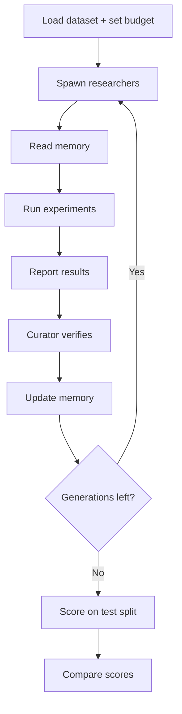

# Shared Brain

A shared memory layer for a team of ML research agents, built on Crusoe Managed Inference.

Every new agent on a team usually starts from zero and pays again for the same context. In Shared Brain, short-lived researcher agents read a shared memory before they work, and a curator keeps that memory **current, lean and conflict-free**. Each generation starts fresh but smarter, and we measure the gain as validation loss.

## How it works



1. The orchestrator spawns a generation of researchers, each with a fixed lifetime.
2. Each researcher reads memory, runs experiments to lower val loss, and reports what it learned.
3. The curator double-checks claims, resolves conflicts and updates memory.
4. The next generation starts fresh from the updated memory.
5. At the end, the starting and best `train.py` are scored once on the hidden test split.

## Memory

The store holds four things:

- **What works:** findings, with proof.
- **What failed:** dead ends not to retry.
- **What to try next:** open questions.
- **Best so far:** the top config and score.

Rules for the memory:

- **Lean:** it has a fixed size cap.
- **Current:** stale or unproven entries are re-tested or removed.
- **Conflict-free:** only the curator writes to it, and contradictions are settled by an experiment.
- **Versioned:** every change is saved.

### Why Crusoe MemoryAlloy

Every researcher's prompt starts with the same memory, so Crusoe's [MemoryAlloy](https://crusoe.ai/resources/blog/crusoe-memoryalloy-reinventing-kv-caching-for-cluster-scale-inference) reads it once and reuses that work for the other researchers. Sharing memory stays cheap and fast: each researcher pays less and starts answering sooner.

## Files

| File | Access |
|---|---|
| `train.py` | The only file agents can edit |
| `test.py` | Locked; agents can't see, edit or run it. Only the orchestrator runs it, at the end |

## Data

Each run uses one dataset, split three ways. There are no other datasets in a run.

| Split | Who sees it | Use |
|---|---|---|
| Train | Researchers, curator | Training |
| Val | Researchers, curator | Scoring during research (`run_code` returns val loss) |
| Test | No agent | Final before-and-after comparison only, run by `test.py` |

- Researchers never see the test split: not its data, its loss, or any score built from it.
- The curator doesn't see it either. It verifies claims on val, because what it learns goes into memory, and researchers read memory.
- The sandbox that `run_code` uses only gets the train and val splits.

### Data sources

We test on three different kinds of problem: a yes/no prediction, a time-series forecast and a numeric prediction. Together they cover a good range of problems to solve. Each dataset gets its own run and is scored on its own test split. All datasets are free to download without a login.

| Problem | What it predicts | Dataset | Val loss | Why this one |
|---|---|---|---|---|
| Churn | Will this customer leave? (yes/no) | [OpenML 46371](https://www.openml.org/d/46371) (35k customers) | Log loss | Clear room to improve (~20%) and stable between runs |
| Inventory | How much stock does each product need? (daily demand per product) | [Walmart M5](https://zenodo.org/records/12636070) sales (~1,000 products) | Pinball loss at 90% | Real retail data; the score measures stock levels, not just the forecast. Room to improve not measured yet |
| Regression | At what temperature does a material become a superconductor? (a number) | [Superconductivity](https://www.openml.org/d/44148) (21k rows) | RMSE | Most room to improve (~47%); 79 features give agents real tuning work |

## Tools

| Tool | What it does |
|---|---|
| `get_memory` | Read memory |
| `upsert_memory` | Add or edit a memory |
| `remove_memory` | Delete a memory |
| `run_code` | Edit and run `train.py` within a fixed budget; returns val loss |
| `web_search` | Look up papers and techniques |

The memory tools are our own, backed by Neon Postgres. Crusoe has no memory API.

## Agents

| Agent | Tools |
|---|---|
| **Researcher** (×4, each with a different focus: optimizer, architecture, regularization, data) | `get_memory`, `web_search`, `run_code` |
| **Curator** (×1) | `get_memory`, `run_code` (to double-check), `upsert_memory`, `remove_memory` |

The orchestrator is a plain Python script, not an agent.

## Rules

- **Reports:** a researcher's final message is its report, which the orchestrator passes to the curator.
- **Memory writes:** only the curator writes to memory.
- **`web_search`:**
  - Researchers only, capped at about 2 searches per lifetime.
  - Web ideas are hypotheses, not facts. Only results from `run_code` become memories.
- **Budget:** enforced inside `run_code` (fixed steps or time), so no one wins by training longer.
- **Test split:** no agent can read it or get a score on it, so nothing tuned on it leaks into memory or `train.py`.

## Curation

Each generation, the N researchers are ranked by **gain over the generation's starting best** (not raw val loss). The curator reads every report; rank decides what it does with each one.

| Rank | Curator action |
|---|---|
| **Top M** | Re-run the claim with `run_code`; if it holds, `upsert_memory` as a fact and update best-so-far |
| **Middle** | Keep only new ideas, as open questions |
| **Bottom** | Record briefly as dead ends so they aren't retried |

- **Losers are kept on purpose:** failed runs are the "what failed" part of memory.
- **Noise:** gaps smaller than seed noise count as ties. Only claims that clear the noise become facts.
- **Budget:** re-running is the curator's expensive step, so ranking decides where it's spent.

## Scoring

```
gain    = (L0 − Lbest) / L0
fitness = average gain across seeds
```

- **`L0`:** baseline loss of the starting `train.py`.
- **`Lbest`:** loss of the best `train.py` reached within the budget.
- During research, both are val loss. For the final score, `test.py` measures both on the test split, with the best `train.py` picked by val loss.

## Evaluation

All setups use the same dataset and budget, and are scored on the same test split.

| Setup | What it shows |
|---|---|
| One-shot | A single agent, a single edit; this is the floor |
| No memory | Every agent starts from zero |
| Raw log | Memory without curation, which bloats and contradicts itself |
| **Shared Brain** | Curated memory: lean and current |

We track four metrics per generation:

- **Quality:** fitness on the test split.
- **Waste:** runs that repeat a known dead end.
- **Memory size:** stays flat while the raw log grows.
- **Cost:** tokens and time-to-first-token per agent (see [Why Crusoe MemoryAlloy](#why-crusoe-memoryalloy)).

## Models (Crusoe Managed Inference)

| Role | Model |
|---|---|
| Researcher | `nvidia/Nemotron-3-Super-120B-A12B` |
| Curator | `nvidia/Nemotron-3-Ultra-550B` |

## Tech stack

| Layer | Tool |
| --- | --- |
| API | [FastAPI](https://fastapi.tiangolo.com) (Python 3.12+, uv) |
| Database | [Neon Postgres](https://neon.com/docs) via SQLAlchemy async + asyncpg, Alembic migrations |
| Object storage | [Neon Object Storage](https://neon.com/docs/storage/overview) (S3-compatible, boto3) |
| LLM inference | [Crusoe Intelligence Foundry](https://console.crusoecloud.com/foundry) (OpenAI-compatible API) |
| Code sandboxes | [Modal Sandboxes](https://modal.com/docs/guide/sandboxes) |

## Setup

```bash
scripts/setup.sh                    # installs tooling, signs in to Modal/Neon/Crusoe, generates a verified .env
uv run python scripts/check_env.py  # re-verify .env anytime (--skip-sandbox for a fast check)
uv run fastapi dev app/main.py
```

Requires Node.js (for the Neon CLI) and access to the team Neon project `patient-art-99467040` (ask the owner to invite your Neon account).

Built at the Crusoe x Cerebral Valley Recursive Agents Hackathon, SF, Oct 2026.
