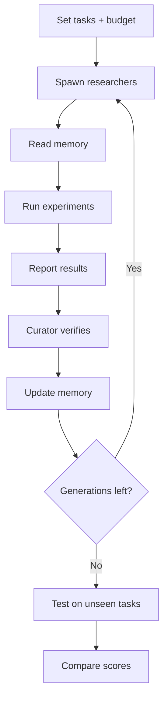

# Shared Brain

A shared memory layer for a team of ML research agents, built on Crusoe Managed Inference.

Every new agent on a team usually starts from zero and pays again for the same context. In Shared Brain, short-lived researcher agents read a shared memory before they work, and a curator keeps that memory **current, lean and conflict-free**. Each generation starts fresh but smarter, and we measure the gain as validation loss.

## How it works



1. The orchestrator spawns a generation of researchers, each with a fixed lifetime.
2. Each researcher reads memory, runs experiments to lower val loss, and reports what it learned.
3. The curator double-checks claims, resolves conflicts and updates memory.
4. The next generation starts fresh from the updated memory.
5. At the end, the system is evaluated on unseen tasks using a hidden test set.

## Memory

The store holds four things:

- **What works:** findings, with proof.
- **What failed:** dead ends not to retry.
- **What to try next:** open questions.
- **Best so far:** the top config and score.

Rules for the memory:

- **Lean:** it has a fixed size cap.
- **Current:** stale or unproven entries are re-tested or removed.
- **Conflict-free:** only the curator writes to it, and contradictions are settled by an experiment.
- **Versioned:** every change is saved.

## Files

| File | Access |
|---|---|
| `train.py` | The only file agents can edit |
| `test.py` | Locked; agents can't see or edit it |

## Data

| Split | Use |
|---|---|
| Train | Training |
| Val | Scoring during research |
| Test | Hidden; used only for the final before-and-after comparison |

Unseen tasks are new datasets with the same three splits.

## Tools

| Tool | What it does |
|---|---|
| `get_memory` | Read memory |
| `upsert_memory` | Add or edit a memory |
| `remove_memory` | Delete a memory |
| `run_code` | Edit and run `train.py` within a fixed budget; returns val loss |
| `web_search` | Look up papers and techniques |

## Agents

| Agent | Tools |
|---|---|
| **Researcher** (×4, each with a different focus: optimizer, architecture, regularization, data) | `get_memory`, `web_search`, `run_code` |
| **Curator** (×1) | `get_memory`, `run_code` (to double-check), `upsert_memory`, `remove_memory` |

The orchestrator is a plain Python script, not an agent.

## Rules

- **Reports:** a researcher's final message is its report, which the orchestrator passes to the curator.
- **Memory writes:** only the curator writes to memory.
- **`web_search`:**
  - Researchers only, capped at about 2 searches per lifetime.
  - Web ideas are hypotheses, not facts. Only results from `run_code` become memories.
- **Budget:** enforced inside `run_code` (fixed steps or time), so no one wins by training longer.
- **Test set:** stays locked so agents can't game the score.

## Curation

Each generation, the N researchers are ranked by **gain over the generation's starting best** (not raw val loss). The curator reads every report; rank decides what it does with each one.

| Rank | Curator action |
|---|---|
| **Top M** | Re-run the claim with `run_code`; if it holds, `upsert_memory` as a fact and update best-so-far |
| **Middle** | Keep only new ideas, as open questions |
| **Bottom** | Record briefly as dead ends so they aren't retried |

- **Losers are kept on purpose:** failed runs are the "what failed" part of memory.
- **Noise:** gaps smaller than seed noise count as ties. Only claims that clear the noise become facts.
- **Budget:** re-running is the curator's expensive step, so ranking decides where it's spent.

## Scoring

```
gain    = (L0 − Lbest) / L0
fitness = average gain across tasks and seeds
```

- **`L0`:** baseline loss of the starting `train.py`.
- **`Lbest`:** best val loss reached within the budget.

## Evaluation

All setups use the same unseen tasks and the same budget.

| Setup | What it shows |
|---|---|
| One-shot | A single agent, a single edit; this is the floor |
| No memory | Every agent starts from zero |
| Raw log | Memory without curation, which bloats and contradicts itself |
| **Shared Brain** | Curated memory: lean and current |

We track four metrics per generation:

- **Quality:** fitness on the test set.
- **Waste:** runs that repeat a known dead end.
- **Memory size:** stays flat while the raw log grows.
- **Cost:** tokens and time-to-first-token per agent. The memory is a shared prompt prefix, so Crusoe's KV cache reuses it.

## Models (Crusoe Managed Inference)

| Role | Model |
|---|---|
| Researcher | `nvidia/Nemotron-3-Super-120B-A12B` |
| Curator | `nvidia/Nemotron-3-Ultra-550B` |

## Tech stack

| Layer | Tool |
| --- | --- |
| API | [FastAPI](https://fastapi.tiangolo.com) (Python 3.12+, uv) |
| Database | [Neon Postgres](https://neon.com/docs) via SQLAlchemy async + asyncpg, Alembic migrations |
| Object storage | [Neon Object Storage](https://neon.com/docs/storage/overview) (S3-compatible, boto3) |
| LLM inference | [Crusoe Intelligence Foundry](https://console.crusoecloud.com/foundry) (OpenAI-compatible API) |
| Code sandboxes | [Modal Sandboxes](https://modal.com/docs/guide/sandboxes) |

## Setup

```bash
scripts/setup.sh                    # installs tooling, signs in to Modal/Neon/Crusoe, generates a verified .env
uv run python scripts/check_env.py  # re-verify .env anytime (--skip-sandbox for a fast check)
uv run fastapi dev app/main.py
```

Requires Node.js (for the Neon CLI) and access to the team Neon project `patient-art-99467040` (ask the owner to invite your Neon account).

## Crusoe API key

The only credential the MVP needs. Create it in **Console → Intelligence Foundry → API keys** (not Admin → Organization Details — that page shows the org ID, not keys). Keys are shown **once**, are project-scoped, and may contain `$`.

Put it in `.env` (gitignored — never commit it):

```bash
echo 'CRUSOE_API_KEY=<paste full key here>' >> .env
```

Verify before a run — a 401 here means the loop will fail at its first inference call:

```bash
curl -s https://api.inference.crusoecloud.com/v1/models \
  -H "Authorization: Bearer $(grep ^CRUSOE_API_KEY= .env | cut -d= -f2-)"
# expect: {"object":"list","data":[{"id":"..."},...]}, NOT {"errors":["Authentication failed"]}
# or: uv run python scripts/check_env.py
```

Gotchas, all seen in practice:

- **Wrong key type (this happened):** Personal Settings → Security lists **Cloud API Keys** ("programmatic access to the Crusoe *Cloud* API" — VMs, disks, S3 buckets) and **Intelligence API Keys** separately. Only an *Intelligence* key works with `api.inference.crusoecloud.com`; a Cloud key 401s there. Create it in the **Intelligence Foundry → Inference → Create API Key** (or the Security page's *Intelligence API Keys*).
- **401 `Authentication failed`** — key truncated during copy/paste (a full key does not end mid-sequence), key from the wrong console page, or the wrong project. Re-create the key and paste the whole thing.
- **`$` in the key** — if you shell-export, use **single quotes**; double quotes interpolate `$...` away. Writing `KEY=value` lines into `.env` is safe either way.
- **404/429/`curl (6)`** — wrong base URL. Current one is `https://api.inference.crusoecloud.com/v1` (in `.env` as `CRUSOE_BASE_URL`); `api.crusoe.ai` and `managed-inference-api-proxy.crusoecloud.com` are outdated.
- **Model IDs are case-sensitive** — copy them from the `/v1/models` response or `GET /playground/models`, not from memory.

## MVP (no infra): run the loop with just a Crusoe key

```bash
uv run python scripts/shared_brain_mvp.py [validation.csv] [--quick]
```

Runs the full generational loop standalone — no Postgres, Neon bucket or Modal needed
(everything in memory; experiment code runs in local `python -c` subprocesses with
timeouts). Steps per generation, per the spec: **run all experiments → curator
summarizes the thinking of the top 10 → web search supplements the learnings
(you.com if `YOU_API_KEY` is set, else keyless DuckDuckGo) → curator generates 100
hypotheses → 100 agents produce experiments testing them → repeat.**

Defaults follow the spec (`--agents 100 --hypotheses 100 --top-k 10`); use `--quick`
for a cheap smoke run (6 agents, 10 hypotheses, 1 generation). Results land in
`shared_brain_results.json`. The same flow, durable and sandboxed (Modal), is
`POST /sessions` (`app/services/orchestrator.py` + `app/services/shared_brain.py`):
researchers (`CRUSOE_RESEARCHER_MODEL`) propose experiments, the curator
(`CRUSOE_CURATOR_MODEL`) summarizes and hypothesizes.

## Dashboard (HTML): projects + orchestration

```bash
uv run python scripts/dashboard_server.py          # http://127.0.0.1:8877
```

**Projects** are the unit of organization: name + goal + uploaded validation CSV
(needs a `y` column; file upload or paste). The UI lists your projects, and each
project page starts runs (agents, fixed hypothesis count, generations, top-k,
concurrency) and shows every past run with its per-iteration results.

Runs execute the **by-phase** loop (1 agents → 2 benchmark → 3 summarize → 4
you.com research → 5 hypotheses) with a live event log, progress bar, and a card
per generation: top experiment, score table, curator summary, research sources,
next-gen hypotheses.

Experiments use the **fit/predict contract**: agents define `fit(rows)` (closed-form
least squares on a chosen basis — pure stdlib) + `predict(row, params)`, so models
are *calibrated from the data* rather than hand-guessed. On the UCI Airfoil
Self-Noise dataset this took the system from RMSE 17.6 dB (hand-set constants) to
4.27 dB, beating the 4.80 dB OLS baseline**.

Everything persists in **SQLite** (`data/dashboard.db`, gitignored) with logical
separation: `projects → runs → generations → experiments` — foreign-keyed per
project, so results never mix across projects. Crusoe and you.com store nothing.
Pre-projects JSON runs under `data/harness_runs/` are imported automatically on
first boot. Runs interrupted by a restart are marked `stopped`, not lost.

## Resilience to LLM errors

Every model call funnels through `inference.chat`, which layers on top of the
SDK's own retry/backoff (`CRUSOE_MAX_RETRIES`):

- **Pacing**: a client RPM limiter (`CRUSOE_RATE_LIMIT_RPM`) keeps runs under the
  account's request window (empirically tighter than the documented 30 RPM).
- **Transient retries**: after the SDK gives up, `CRUSOE_CHAT_ATTEMPTS` extra
  attempts with exponential backoff (`CRUSOE_CHAT_BACKOFF_SECONDS`; 429s get a
  longer cooldown).
- **Model fallbacks**: `CRUSOE_FALLBACK_MODELS` is an ordered chain — a model
  that 404s/400s (or exhausts its retries) is skipped and the next one serves
  the call. Verified live: a bogus model and a listed-but-unserveable model
  were both skipped, and `gpt-oss-120b` served the call.
- **Budget retry**: a reasoning model that burns `max_tokens` on thinking and
  returns empty content is retried once with a doubled budget.

Phase level (`HarnessRunner`, MVP script): a failed agent becomes a scored-0
error stub (never a dead run); a failed hypothesis batch just loses that batch
(the fixed count is padded); failed research/hypotheses phases **degrade** (no
sources, carry-over hypotheses) and are logged as `DEGRADED` events — a down
curator costs a generation its guidance, not the generation itself.

Built at the Crusoe x Cerebral Valley Recursive Agents Hackathon, SF, Oct 2026.
